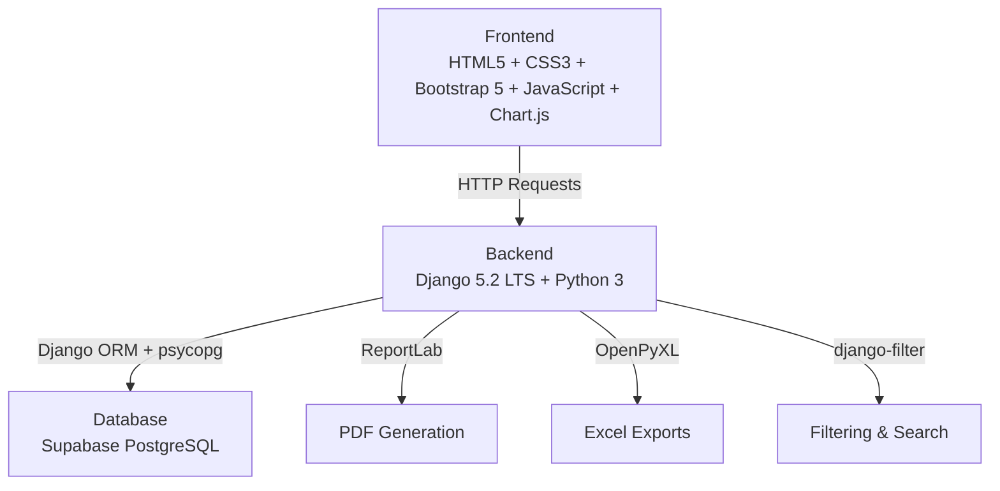
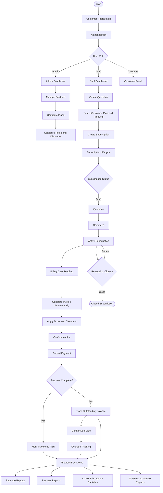
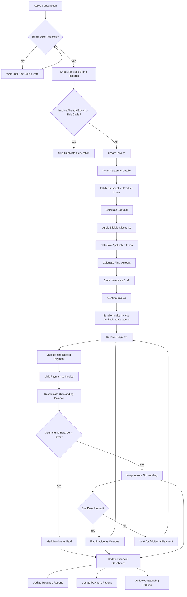
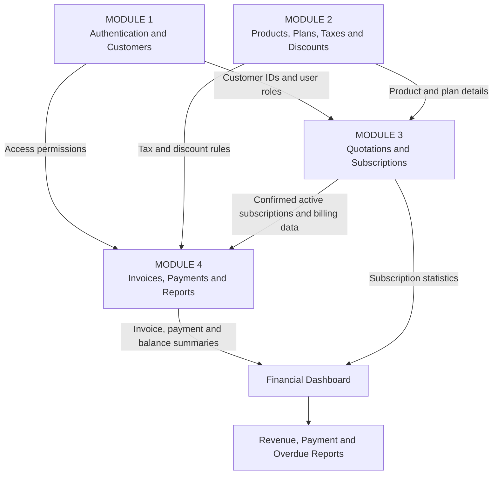
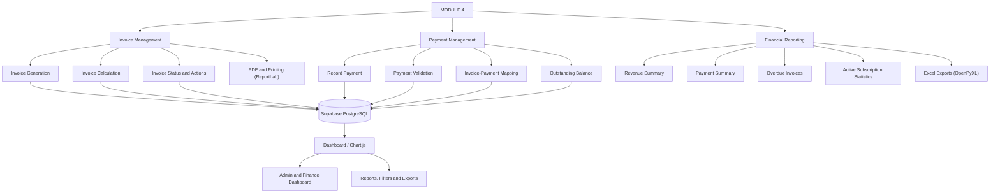
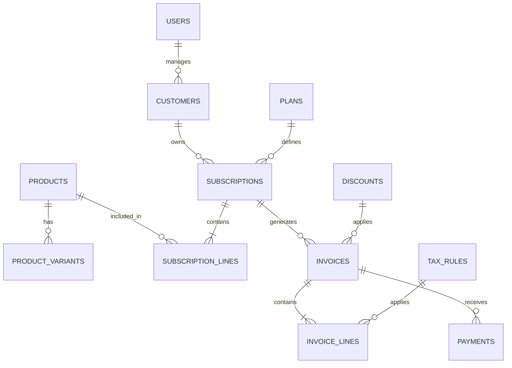
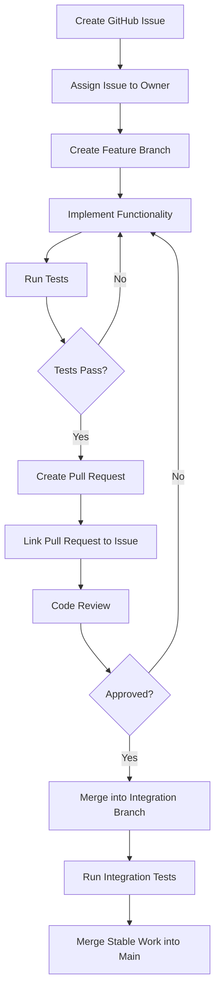

# Subscription Management System

A unified platform for managing products, subscription plans,
quotations, recurring invoices, payments, and financial reporting.

> **Project scenario:** Brightloop Software\
> This README describes the system workflow, technology stack, and the
> responsibilities of the four development modules. It is the team's
> shared reference for implementation and integration.

---

## Table of Contents

1.  [Project Overview](#1-project-overview)
2.  [Project Objectives](#2-project-objectives)
3.  [Technology Stack](#3-technology-stack)
4.  [System Architecture](#4-system-architecture)
5.  [User Roles and Permissions](#5-user-roles-and-permissions)
6.  [Project Modules and Team Responsibilities](#6-project-modules-and-team-responsibilities)
7.  [Overall System Workflow](#7-overall-system-workflow)
8.  [Invoice and Payment Workflow](#8-invoice-and-payment-workflow)
9.  [Module Integration Diagram](#9-module-integration-diagram)
10. [Conceptual Database Relationships](#10-conceptual-database-relationships)
11. [Important Business Rules](#11-important-business-rules)
12. [Database and Security Design](#12-database-and-security-design)
13. [Installation and Setup Instructions](#13-installation-and-setup-instructions)
14. [Required Python Packages](#14-required-python-packages)
15. [Environment Variable Configuration](#15-environment-variable-configuration)
16. [GitHub Collaboration Workflow](#16-github-collaboration-workflow)
17. [Testing Checklist](#17-testing-checklist)
18. [Performance Requirements](#18-performance-requirements)
19. [Future Improvements](#19-future-improvements)
20. [Project Status](#20-project-status)

---

## 1. Project Overview

The Subscription Management System manages the full lifecycle of a
subscription business:

-   Customer registration and account access.
-   Product and subscription plan configuration.
-   Product variants, taxes, and discounts.
-   Quotations and subscription creation.
-   Recurring invoice generation.
-   Payment recording and outstanding balance tracking.
-   Financial dashboards and reports.

The system is intended to replace manual spreadsheet tracking, manually
prepared invoices, and manually reconciled payments.

---

## 2. Project Objectives

-   Reduce missed renewals and billing errors.
-   Prevent duplicate invoices and duplicate payment records.
-   Keep subscription, invoice, and payment information consistent.
-   Give customers access only to their own subscriptions and invoices.
-   Give authorized staff and administrators the tools required for
    daily operations.
-   Make financial information available through searchable reports and
    dashboards.
-   Keep pages responsive with thousands of subscription records; the
    project brief specifies a target of under two seconds.

---

## 3. Technology Stack

### Backend

| Component       | Technology         |
|-----------------|--------------------|
| Language        | Python 3           |
| Framework       | Django 5.2 LTS     |

### Database

| Component       | Technology            |
|-----------------|-----------------------|
| Database        | Supabase PostgreSQL   |
| ORM             | Django ORM            |
| Driver          | psycopg (PostgreSQL)  |

### Frontend

| Component       | Technology      |
|-----------------|-----------------|
| Markup          | HTML5           |
| Styling         | CSS3            |
| CSS Framework   | Bootstrap 5     |
| Scripting       | JavaScript      |

### Additional Libraries

| Library           | Purpose                            |
|-------------------|------------------------------------|
| ReportLab         | PDF invoice generation             |
| OpenPyXL          | Excel report generation            |
| Pillow            | Image handling                     |
| django-filter     | Filtering and searching            |
| python-decouple   | Environment variable management    |
| Chart.js          | Dashboard charts (frontend)        |

### Development Tools

| Tool                  | Purpose                          |
|-----------------------|----------------------------------|
| Visual Studio Code    | Code editor                      |
| Git and GitHub        | Version control and collaboration|
| Postman               | API testing (optional)           |
| pgAdmin               | Database management (optional)   |

---

## 4. System Architecture

```
Frontend (HTML + CSS + Bootstrap + JavaScript)
                    ↓
Backend (Django + Python)
                    ↓
Database (Supabase PostgreSQL)
```



### Architecture details

-   **Django** handles application logic, authentication, permissions,
    validation, and all business operations.
-   **Supabase** provides hosted PostgreSQL database services.
-   Django connects directly to Supabase PostgreSQL using **psycopg**
    and **Django ORM**. No Supabase client SDK is required.
-   **Django authentication** is used for user login, session
    management, and role-based access control. Supabase Auth is not
    required.
-   Database credentials must remain in environment variables managed
    by **python-decouple** and must never be exposed in frontend code.
-   Database access must be protected through Django's permission
    framework and appropriate security controls.

---

## 5. User Roles and Permissions

| Role            | Main Responsibilities                                                                                         |
|-----------------|---------------------------------------------------------------------------------------------------------------|
| Admin           | Manage the system, staff accounts, products, plans, taxes, and discount rules; access financial information.   |
| Internal Staff  | Handle permitted customer, quotation, subscription, invoice, and payment operations.                          |
| Customer        | Access and manage their own account, subscriptions, and invoices through the customer portal.                  |

**Access rule:** Only an admin can create staff accounts. Backend
authorization must enforce role permissions; hiding a button in the
frontend is not sufficient.

---

## 6. Project Modules and Team Responsibilities

| Module    | Owner    | Main Deliverables                                                                                |
|-----------|----------|--------------------------------------------------------------------------------------------------|
| Module 1  | Member 1 | Authentication, customer management, roles, and access control                                   |
| Module 2  | Member 2 | Products, variants, plans, tax rules, and discounts                                              |
| Module 3  | Member 3 | Quotation templates, quotations, subscriptions, and lifecycle                                    |
| Module 4  | Member 4 | Invoice management, payments, financial dashboard, and reports                                   |

### Module 1: Authentication & Customer Management

-   Registration and login.
-   User roles: Admin, Staff, and Customer.
-   Password validation and reset.
-   Customer management.
-   Role-based permissions.

### Module 2: Products, Plans, Taxes & Discounts

-   Product and variant management.
-   Subscription plan management.
-   Billing frequency configuration.
-   Tax configuration.
-   Discount rules.

### Module 3: Quotations & Subscription Management

-   Quotation creation and management.
-   Quotation validity tracking.
-   Quotation-to-subscription conversion.
-   Subscription lifecycle management.
-   Subscription renewal, pause, and closure.

### Module 4: Invoices, Payments & Financial Reports

-   Automatic invoice generation.
-   Invoice status management.
-   PDF invoice generation (ReportLab).
-   Payment recording.
-   Outstanding and overdue tracking.
-   Revenue reports.
-   Payment reports.
-   Financial dashboard (Chart.js).
-   Excel exports (OpenPyXL).

#### Module 4 issue breakdown

| Issue | Scope                                       | Priority  |
|-------|---------------------------------------------|-----------|
| #1    | Automatic invoice generation                | High      |
| #2    | Invoice status and lifecycle                | High      |
| #3    | Invoice viewing, PDF, and printing          | Medium    |
| #4    | Payment recording system                    | High      |
| #5    | Outstanding balance and overdue tracking    | High      |
| #6    | Admin financial dashboard                   | Medium    |
| #7    | Revenue and payment reports                 | Medium    |
| #8    | Invoice and payment filtering               | Medium    |
| #9    | Billing validation and duplicate prevention | High      |
| #10   | Performance optimization and testing        | Important |

---

## 7. Overall System Workflow

This diagram shows the main journey from customer registration to
billing and financial reporting.



### Workflow notes

-   A customer registers and authenticates before accessing protected
    features.
-   Admins configure products, plans, tax rules, and discount rules.
-   Staff prepare quotations and convert accepted quotations into
    subscriptions.
-   Active subscriptions become eligible for recurring billing according
    to their billing schedule.
-   The billing process creates an invoice, applies the relevant pricing
    rules, and makes it available for confirmation and sending.
-   Payments are recorded against invoices.
-   Outstanding and overdue balances are reflected in financial views.
-   Subscription renewal and closure are controlled by the subscription
    lifecycle rules.

---

## 8. Invoice and Payment Workflow

This is the detailed workflow for **Module 4: Invoices, Payments &
Reports**.



### Invoice and payment rules

1.  An invoice must be generated from the relevant subscription and
    billing cycle.
2.  Invoice generation must be idempotent: retrying the same billing
    operation must not create another invoice for the same subscription
    and cycle.
3.  Invoice totals must be calculated consistently using the agreed tax
    and discount rules.
4.  A payment must reference the invoice it pays.
5.  If partial payments are supported, multiple payment records may be
    linked to one invoice.
6.  Outstanding balance is calculated as the invoice amount minus valid
    payments and any explicitly supported adjustments.
7.  An invoice is fully paid only when its outstanding balance is zero.
8.  An invoice with a positive outstanding balance becomes overdue when
    its due date has passed, subject to the agreed cancellation and
    status rules.
9.  Cancelled invoices must not be counted as collected revenue.
10. Payment retries must not create duplicate payment records. Use a
    unique payment reference or idempotency key where available.

> **Status design note:** The project brief lists Draft, Confirmed, and
> Paid as invoice statuses. Partial payment and overdue are useful
> financial conditions. The team should decide whether these are
> additional persisted statuses or derived display states, and document
> that decision consistently.

---

## 9. Module Integration Diagram

The four modules are developed separately but share data and depend on
one another.



### Integration dependencies

| Module                                  | Provides                                    | Used By                            |
|-----------------------------------------|---------------------------------------------|------------------------------------|
| Module 1: Authentication & Customers    | User IDs, customer IDs, roles, permissions  | Modules 3 and 4                    |
| Module 2: Products, Plans, Taxes        | Product, variant, plan, tax, discount data  | Modules 3 and 4                    |
| Module 3: Quotations & Subscriptions    | Subscription ID, customer, billing dates, subscription lines, lifecycle status | Module 4 |
| Module 4: Invoices, Payments & Reports  | Invoice records, payment records, balances, financial summaries | Dashboard and customer/staff views |

### Integration sequence

1.  Agree on shared identifiers and database relationships.
2.  Module 1 establishes users, customers, and role permissions.
3.  Module 2 establishes products, plans, taxes, and discount rules.
4.  Module 3 uses customer and product data to create subscriptions.
5.  Module 4 consumes eligible subscription data to generate invoices
    and record payments.
6.  The dashboard and reports read consistent data from the shared
    database.

### Module 4 internal architecture

Module 4 contains three major areas: invoice management, payment
management, and financial reporting.



### Suggested Module 4 URL patterns

The exact URL patterns depend on the team's Django project structure.
Agree on view names and URL conventions before parallel implementation.

| Operation                        | Purpose                                              |
|----------------------------------|------------------------------------------------------|
| `GET /invoices/`                 | List invoices with pagination and filters.           |
| `GET /invoices/<id>/`            | Retrieve one invoice and its lines.                  |
| `POST /invoices/generate/`       | Generate an invoice for an eligible subscription.    |
| `POST /invoices/<id>/confirm/`   | Confirm an eligible draft invoice.                   |
| `POST /invoices/<id>/cancel/`    | Cancel an eligible invoice.                          |
| `GET /invoices/<id>/pdf/`        | Generate or retrieve a printable PDF invoice.        |
| `GET /invoices/<id>/payments/`   | List payments associated with an invoice.            |
| `POST /payments/`                | Record a payment against an invoice.                 |
| `GET /payments/`                 | List payments with pagination and filters.           |
| `GET /reports/summary/`          | Retrieve financial dashboard summary data.           |
| `GET /reports/revenue/`          | Retrieve revenue report data.                        |
| `GET /reports/outstanding/`      | Retrieve outstanding and overdue invoice data.       |
| `GET /reports/export/excel/`     | Export report data as Excel file.                    |

---

## 10. Conceptual Database Relationships

The following is a conceptual relationship diagram. It is a discussion
baseline, not a finalized database schema. Confirm table names, keys,
optional relationships, and cardinalities with all module owners before
implementing migrations.



### Important data concepts

-   **Customer:** The customer account that owns subscriptions and
    receives invoices.
-   **Subscription:** The agreement that defines the customer, plan,
    billing schedule, dates, and lifecycle state.
-   **Subscription line:** The products, quantities, and agreed prices
    included in a subscription.
-   **Invoice:** A billing record for a subscription and a specific
    billing cycle.
-   **Invoice line:** The billed product/service, quantity, unit price,
    tax, discount allocation, and line total.
-   **Payment:** A recorded payment with amount, method, date, note, and
    invoice reference.
-   **Tax and discount rules:** Configured rules used when calculating
    eligible invoice amounts.

---

## 11. Important Business Rules

### Billing rules

-   No duplicate invoices for the same subscription billing cycle.
    Invoice generation must be idempotent.
-   Correct tax and discount calculations must be applied consistently.
-   Use Python `Decimal` for all financial calculations. Do not use
    floating-point arithmetic.
-   An invoice is marked as **Paid** only when its outstanding balance
    reaches zero.
-   An invoice is **Overdue** when its due date has passed and an
    outstanding balance remains.
-   Payments must be linked to the correct invoice.
-   Historical invoice calculations must remain consistent. Later
    changes to a product price, tax rule, or discount must not silently
    rewrite previously generated invoices.
-   Cancelled invoices must not be counted as collected revenue.

### Shared contracts

Before implementation, all four members should agree on:

-   Customer, user, product, plan, subscription, invoice, and payment
    identifiers.
-   Django model names and ownership.
-   URL patterns and view conventions.
-   Date, time, timezone, currency, and rounding conventions.
-   Role permissions and which module enforces them.
-   Error response format and validation conventions.

### Billing design decisions

The team should document agreed answers to:

-   What event or scheduled job triggers recurring billing?
-   How is a billing cycle uniquely identified?
-   What happens if invoice generation fails and retries?
-   Which date determines the invoice due date?
-   Can an invoice be partially paid?
-   How are overpayments handled?
-   Which invoice states can be cancelled?
-   How are refunds, reversals, and failed payments represented, if
    supported?
-   Does a discount apply to the next invoice, and how is its usage
    limit reserved or consumed?

Record agreed answers in the project documentation. Do not let different
modules implement conflicting rules.

---

## 12. Database and Security Design

### Data consistency rules

-   Use stable primary keys and foreign keys (Django auto-generated IDs
    or UUIDs as agreed by the team).
-   Store monetary amounts using `DecimalField` with appropriate
    `max_digits` and `decimal_places`. Never use `FloatField` for money.
-   Define currency and rounding rules.
-   Store timestamps consistently using Django's timezone-aware
    `DateTimeField` and apply the business timezone when determining
    billing and due dates.
-   Preserve the invoice calculation details used at the time of
    billing, so later changes to a product or tax rule do not silently
    rewrite historical invoices.
-   Use database transactions (`django.db.transaction.atomic`) for
    operations that must update multiple related records together.
-   Add `db_index=True` for frequently filtered fields such as customer
    ID, subscription ID, invoice number, status, due date, and payment
    date.

### Security rules

-   Database credentials must be stored in environment variables using
    `python-decouple`. Never hardcode credentials in source code.
-   Database credentials must never be exposed in frontend code.
-   Database access must be protected through Django's permission
    framework.
-   All views must enforce role-based access control on the backend.
    Hiding UI elements is not sufficient.
-   Customers can only view their own invoices and subscriptions.
-   Staff cannot perform admin-only actions.
-   `DEBUG` must be set to `False` in production.
-   `SECRET_KEY` must be unique and kept secret.

---

## 13. Installation and Setup Instructions

### Prerequisites

-   Python 3.10 or later
-   pip (Python package manager)
-   Git
-   A Supabase account (free tier is sufficient for development)

### Step 1: Clone the repository

```bash
git clone <YOUR_REPOSITORY_URL>

cd <PROJECT_FOLDER>
```

### Step 2: Create and activate a virtual environment

```bash
python -m venv venv
```

**Windows activation:**

```bash
venv\Scripts\activate
```

**macOS / Linux activation:**

```bash
source venv/bin/activate
```

### Step 3: Install dependencies

```bash
pip install django "psycopg[binary]" pillow reportlab openpyxl django-filter python-decouple
```

### Step 4: Create Supabase project

1.  Go to [https://supabase.com](https://supabase.com) and create a new
    project.
2.  Navigate to **Project Settings → Database**.
3.  Note the following connection details:
    -   Host
    -   Database name
    -   Port
    -   User
    -   Password

### Step 5: Configure environment variables

Create a `.env` file in the project root (copy from `.env.example`):

```bash
cp .env.example .env
```

Fill in your Supabase PostgreSQL connection details and Django settings.
See the [Environment Variable Configuration](#15-environment-variable-configuration)
section for details.

### Step 6: Create Django project (example)

> **Note:** These commands are documented as examples for initial setup.
> They should only be run once when first creating the project structure.

```bash
# Create Django project
django-admin startproject subscription_management .

# Create Django apps (one per module)
python manage.py startapp accounts
python manage.py startapp products
python manage.py startapp subscriptions
python manage.py startapp invoices
```

### Step 7: Configure Django database settings

In `settings.py`, configure the database connection using
`python-decouple`:

```python
from decouple import config

DATABASES = {
    'default': {
        'ENGINE': 'django.db.backends.postgresql',
        'NAME': config('DB_NAME'),
        'USER': config('DB_USER'),
        'PASSWORD': config('DB_PASSWORD'),
        'HOST': config('DB_HOST'),
        'PORT': config('DB_PORT', default='5432'),
    }
}
```

### Step 8: Run migrations

```bash
python manage.py makemigrations
python manage.py migrate
```

### Step 9: Create a superuser

```bash
python manage.py createsuperuser
```

### Step 10: Start the development server

```bash
python manage.py runserver
```

The application will be available at `http://127.0.0.1:8000/`.

---

## 14. Required Python Packages

| Package           | Version      | Purpose                         |
|-------------------|--------------|---------------------------------|
| Django            | 5.2 LTS      | Web framework                   |
| psycopg[binary]   | Latest       | PostgreSQL database driver      |
| Pillow            | Latest       | Image handling                  |
| ReportLab         | Latest       | PDF invoice generation          |
| OpenPyXL          | Latest       | Excel report generation         |
| django-filter     | Latest       | Filtering and searching         |
| python-decouple   | Latest       | Environment variable management |

### Generating requirements.txt

After installing all packages, generate a `requirements.txt` file:

```bash
pip freeze > requirements.txt
```

To install from an existing `requirements.txt`:

```bash
pip install -r requirements.txt
```

---

## 15. Environment Variable Configuration

### `.env.example`

```env
# Django Settings
SECRET_KEY=your-secret-key-here
DEBUG=True
ALLOWED_HOSTS=127.0.0.1,localhost

# Supabase PostgreSQL Database
DB_NAME=postgres
DB_USER=postgres.your-project-ref
DB_PASSWORD=your-database-password
DB_HOST=aws-0-region.pooler.supabase.com
DB_PORT=5432
```

> **Important:** Never commit the `.env` file to version control. Ensure
> `.env` is listed in `.gitignore`. The `.env.example` file should
> contain placeholder values only.

---

## 16. GitHub Collaboration Workflow

Use separate feature branches so that each member can work
independently.



### Suggested branch names

```text
main
integration

feature/auth-customer
feature/products-plans
feature/quotations-subscriptions
feature/invoices-payments
feature/financial-reports
```

### Team rules

1.  Do not commit unfinished work directly to `main`.
2.  Create a GitHub Issue for each independently trackable task or bug.
3.  Work on a feature branch.
4.  Commit changes with clear messages.
5.  Include database migrations and relevant tests in the Pull Request.
6.  Link each Pull Request to its GitHub Issue.
7.  Request review before merging.
8.  Test the integrated workflow, not only individual modules.
9.  Do not overwrite another member's migrations or shared model
    definitions without discussion.
10. Keep the README updated when an agreed workflow or contract changes.

### Required Pull Request submission

Each member should provide:

-   Source code for the assigned functionality.
-   Database migrations or schema changes.
-   Django URL patterns and view documentation.
-   Screenshots or a short demonstration.
-   Test cases and results.
-   Known bugs and unresolved issues.
-   A Pull Request linked to the relevant issue.

---

## 17. Testing Checklist

### Invoice tests

-   [ ] Invoice generated for an eligible subscription.
-   [ ] No invoice generated before the billing date.
-   [ ] Duplicate generation attempt is safely rejected or ignored.
-   [ ] Customer and subscription details are correct.
-   [ ] Product lines and quantities are correct.
-   [ ] Tax and discount calculations are correct.
-   [ ] Invoice total and rounding are correct.
-   [ ] Invalid status transitions are rejected.
-   [ ] PDF and print output are accurate.

### Payment tests

-   [ ] Valid payment is recorded.
-   [ ] Payment is linked to the correct invoice.
-   [ ] Partial payment updates the outstanding balance.
-   [ ] Full payment changes the invoice to Paid.
-   [ ] Zero and negative payment amounts are rejected.
-   [ ] Payment above the outstanding balance follows the agreed
    overpayment rule.
-   [ ] Retried payment requests do not create duplicates.
-   [ ] Payment history is accurate.

### Reporting tests

-   [ ] Revenue includes only amounts counted as received under the
    agreed accounting rule.
-   [ ] Outstanding balances match invoice and payment records.
-   [ ] Overdue invoices use the correct due-date logic.
-   [ ] Active subscription counts match subscription records.
-   [ ] Date and status filters return correct results.
-   [ ] Exported reports match displayed data.
-   [ ] Large lists use pagination or another agreed strategy.
-   [ ] Key pages meet the under-two-second response target in the
    agreed test environment.

### Security tests

-   [ ] Customers can only view their own invoices and subscriptions.
-   [ ] Staff cannot perform admin-only actions.
-   [ ] Unauthorized requests are rejected.
-   [ ] Payment and invoice operations validate ownership and
    permissions on the backend.

---

## 18. Performance Requirements

-   Key pages must load within **two seconds** in the agreed test
    environment.
-   Large lists (invoices, payments, subscriptions) must use
    **pagination** through Django's built-in pagination or
    django-filter.
-   Database queries should be optimized with appropriate indexes
    (`db_index=True`) on frequently filtered fields.
-   Use `select_related()` and `prefetch_related()` to minimize
    database queries in list views.
-   Avoid N+1 query patterns.

---

## 19. Future Improvements

-   Email notifications for invoice delivery and payment confirmations.
-   Supabase Auth integration for additional authentication options.
-   REST API layer using Django REST Framework for external integrations.
-   Automated scheduled billing using Django management commands with
    cron or task queues.
-   Multi-currency support.
-   Customer self-service payment portal.
-   Advanced analytics and trend reporting.

---

## 20. Project Status

> **Current status:** Planning and initial setup phase.
>
> The technology stack has been finalized. Module responsibilities have
> been assigned. Implementation has not yet begun.

| Milestone                        | Status      |
|----------------------------------|-------------|
| Technology stack finalized       | ✅ Complete  |
| Module responsibilities assigned | ✅ Complete  |
| Database schema design           | 🔲 Planned  |
| Module 1: Auth & Customers       | 🔲 Planned  |
| Module 2: Products & Plans       | 🔲 Planned  |
| Module 3: Quotations & Subs      | 🔲 Planned  |
| Module 4: Invoices & Payments    | 🔲 Planned  |
| Integration testing              | 🔲 Planned  |
| Final deployment                 | 🔲 Planned  |

---

## Project Reference

Use this README as the shared reference for system flow and module
integration. If an implementation decision differs from a diagram,
discuss and document the change so that all four modules continue to
follow the same contracts.

**Primary integration path:**

`Users and Customers → Products and Plans → Quotations and Subscriptions → Invoices and Payments → Financial Reports`
