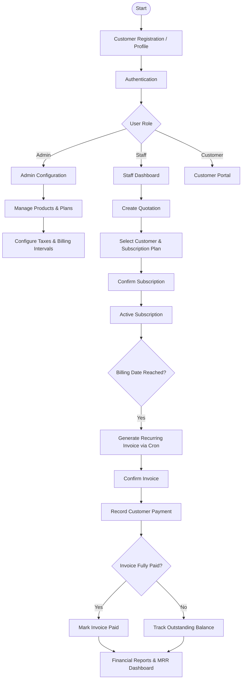

# Subscription Management System (Odoo)

A standardized, multi-tier Odoo platform for managing products, subscription plans, quotations, recurring contracts, invoices, payments, and financial reporting.

> **Project scenario:** Brightloop Software  
> Developed as part of an international hackathon by a 4-developer engineering team working across modular boundaries with a standardized architecture.

---

## Table of Contents

1. [Project Overview](#1-project-overview)
2. [Project Objectives](#2-project-objectives)
3. [Technology Stack](#3-technology-stack)
4. [Repository Structure](#4-repository-structure)
5. [Module Descriptions](#5-module-descriptions)
6. [User Roles](#6-user-roles)
7. [System Workflows](#7-system-workflows)
8. [Invoice and Payment Workflow](#8-invoice-and-payment-workflow)
9. [Installation & Development Setup](#9-installation--development-setup)
10. [Testing & Quality Verification](#10-testing--quality-verification)
11. [Contribution & Git Guidelines](#11-contribution--git-guidelines)

---

## 1. Project Overview

The **Subscription Management System** automates the entire recurring revenue lifecycle for modern subscription-based businesses:

- **Customer Registration & Access:** Role-based portal access and account management.
- **Product & Plan Catalog:** Flexible recurring plans (daily, weekly, monthly, annual) and trial periods.
- **Quotations & Subscriptions:** Contract creation, line item configuration, and lifecycle state management.
- **Automated Recurring Billing:** Idempotent recurring invoice generation, automated payment recording, and balance tracking.
- **Financial Dashboards & Analytics:** Real-time reporting on Monthly Recurring Revenue (MRR), Annual Recurring Revenue (ARR), and outstanding receivables.

The system replaces error-prone spreadsheet tracking and manual billing workflows with native Odoo accounting integration.

---

## 2. Project Objectives

- **Idempotent Recurring Billing:** Eliminate double-billing and missed billing dates with automated cron-based invoice generation.
- **Native Odoo Reuse:** Eliminate duplicate data models by extending Odoo's native `res.partner`, `product.template`, `account.move`, and `account.payment`.
- **Role-Based Security:** Strict backend enforcement ensuring customers only access their own subscriptions, while internal staff and administrators have proper role segregation.
- **High Performance:** Maintain sub-2-second response times under large volumes of subscription contracts using database indexing and optimized SQL reporting views.
- **Modular Autonomy:** Enable independent, parallel feature development across four developers with zero merge conflicts or cyclic dependencies.

---

## 3. Technology Stack

- **Platform / Framework:** Odoo (Compatible with Odoo 16.0 / 17.0 / 18.0 Community and Enterprise)
- **Programming Language:** Python 3.10+ (compatible with Python 3.9+)
- **Database:** PostgreSQL 14+
- **Frontend / Views:** Odoo QWeb XML views, JavaScript OWL (Odoo Web Library)
- **Reporting Engine:** QWeb PDF (ReportLab) & SQL Analysis Views
- **Developer & Quality Toolchain:** Flake8, Black, Pylint-Odoo, PyTest

---

## 4. Repository Structure

```text
subscription-management/
│
├── addons/                         # Business modules developed for the system
│   ├── subscription_base/          # Shared foundation (root menu, settings, audit mixins)
│   ├── subscription_auth/          # Customer profiles, portal access & authentication (Module 1)
│   ├── subscription_catalog/       # Products, recurring plans, taxes & discounts (Module 2)
│   ├── subscription_management/    # Quotations, contracts & subscription lifecycle (Module 3)
│   ├── subscription_billing/       # Recurring invoicing, payments & accounting (Module 4)
│   ├── subscription_reports/       # Dedicated analytics, pivot analysis & reporting
│   └── subscription_module_template/# Reusable scaffold boilerplate for new features
│
├── config/                         # Odoo server configuration
│   └── odoo.conf.example           # Version-controlled configuration template (no secrets)
│
├── docs/                           # Architecture, guidelines & integration documentation
│   ├── PROJECT_STRUCTURE.md        # Detailed directory breakdown and file responsibilities
│   ├── DEVELOPMENT_GUIDELINES.md   # Coding standards, naming conventions, and Git rules
│   └── MODULE_DEPENDENCIES.md      # Dependency graph, DAG hierarchy, and native model mappings
│
├── scripts/                        # Automation and developer tooling
│   ├── setup_dev.sh                # Virtual environment & configuration setup script
│   ├── validate_modules.py         # Syntax, manifest, and dependency cycle validator
│   └── run_tests.sh                # Automated test runner and pipeline validation
│
├── .gitignore                      # Git exclusion rules (bytecode, virtualenvs, logs, configs)
├── README.md                       # Main project documentation (this file)
└── requirements.txt                # Python runtime dependencies & quality tools
```

---

## 5. Module Descriptions

| Module Technical Name | Display Name | Assigned Area | Key Responsibilities |
|---|---|---|---|
| `subscription_base` | Subscription Base | Shared Foundation | Top-level root application menus, system user groups (`group_subscription_user`, `group_subscription_manager`), `res.config.settings`, and shared `subscription.audit.mixin`. |
| `subscription_auth` | Authentication & Customers | Module 1 | Extends `res.partner` (`is_subscription_customer`) and customer portal access, isolating subscriber data by user identity. |
| `subscription_catalog` | Subscription Catalog | Module 2 | Defines recurring billing plans (`subscription.plan`), recurrence periods (daily, monthly, yearly), trial days, and extends `product.template`. |
| `subscription_management` | Quotations & Subscriptions | Module 3 | Core subscription engine (`subscription.subscription`), contract lines, quotation sending, and lifecycle states (Draft -> Quotation -> Active -> Paused -> Closed). |
| `subscription_billing` | Subscription Billing | Module 4 | Extends native `account.move` with `subscription_id`, automated recurring invoice creation cron (`ir.cron`), and payment state sync. |
| `subscription_reports` | Reports & Analytics | Analytics | Materialized SQL view (`subscription.report`), pivot charts, cohort breakdown, and revenue dashboards. |
| `subscription_module_template`| Module Template | Boilerplate Scaffold | Standard reusable template containing models, views, controllers, security, data, demo, wizard, report, and tests. |

For detailed inter-module relationships, see [MODULE_DEPENDENCIES.md](docs/MODULE_DEPENDENCIES.md).

---

## 6. User Roles

| Role | Main Responsibilities | Access Level |
|---|---|---|
| **Administrator** | System configuration, staff management, product catalog, financial overrides. | Full administrative access (`group_subscription_manager`). |
| **Internal Staff** | Customer inquiries, preparing quotations, activating contracts, viewing invoices. | Standard operational access (`group_subscription_user`). |
| **Customer** | Access own subscription contracts, view invoices, download PDFs via portal. | Portal user access (`base.group_portal`), scoped by record rule. |

---

## 7. System Workflows



---

## 8. Invoice and Payment Workflow

```mermaid
flowchart TD
    A[Active Subscription] --> B{Billing Date Reached?}
    B -->|No| C[Wait for Scheduled Run]
    B -->|Yes| D[Check Billing History]

    D --> E{Invoice Exists for Cycle?}
    E -->|Yes| F[Skip Generation (Idempotent)]
    E -->|No| G[Generate Native account.move]

    G --> H[Apply Pricing & Taxes]
    H --> I[Save Draft / Post Invoice]
    I --> J[Customer Receives Notification]

    J --> K[Record Payment]
    K --> L[Reconcile Invoice]
    L --> M{Balance = 0?}
    M -->|Yes| N[Status: Paid]
    M -->|No| O[Status: Partially Paid / Open]
```

---

## 9. Installation & Development Setup

### Prerequisites
- Python 3.10+ (or Python 3.9+)
- PostgreSQL 14+
- Git

### Quick Setup

1. **Clone the repository:**
   ```bash
   git clone <REPOSITORY_URL>
   cd "Odoo hackathon"
   ```

2. **Run the automated setup script:**
   ```bash
   ./scripts/setup_dev.sh
   ```
   This will:
   - Create a Python virtual environment in `.venv/`.
   - Install required packages from `requirements.txt`.
   - Copy `config/odoo.conf.example` to `config/odoo.conf`.
   - Validate module manifests and syntax.

3. **Configure local database credentials:**
   Edit `config/odoo.conf`:
   ```ini
   addons_path = addons,/path/to/odoo/addons
   db_host = 127.0.0.1
   db_port = 5432
   db_user = odoo
   db_password = your_password
   db_name = subscription_dev
   ```

4. **Initialize Odoo database with project modules:**
   ```bash
   odoo-bin -c config/odoo.conf -d subscription_dev -i subscription_base,subscription_auth,subscription_catalog,subscription_management,subscription_billing,subscription_reports
   ```

5. **Start the development server:**
   ```bash
   odoo-bin -c config/odoo.conf -d subscription_dev
   ```
   Access the web interface at `http://localhost:8069`.

---

## 10. Testing & Quality Verification

### Run Automated Static & Manifest Validation
Validate all module manifests, dependencies, XML views, and security CSVs without needing a running database:
```bash
python3 scripts/validate_modules.py
```

### Run Odoo Test Suites
```bash
./scripts/run_tests.sh
```

---

## 11. Contribution & Git Guidelines

- All feature work must be done on dedicated branches (`epic-<number>-<feature>` or `feature/<name>`).
- Follow the [DEVELOPMENT_GUIDELINES.md](docs/DEVELOPMENT_GUIDELINES.md) for coding and commit formats.
- Run `python3 scripts/validate_modules.py` before pushing code.
- Pull requests require review and passing static checks before merging into `main`.
