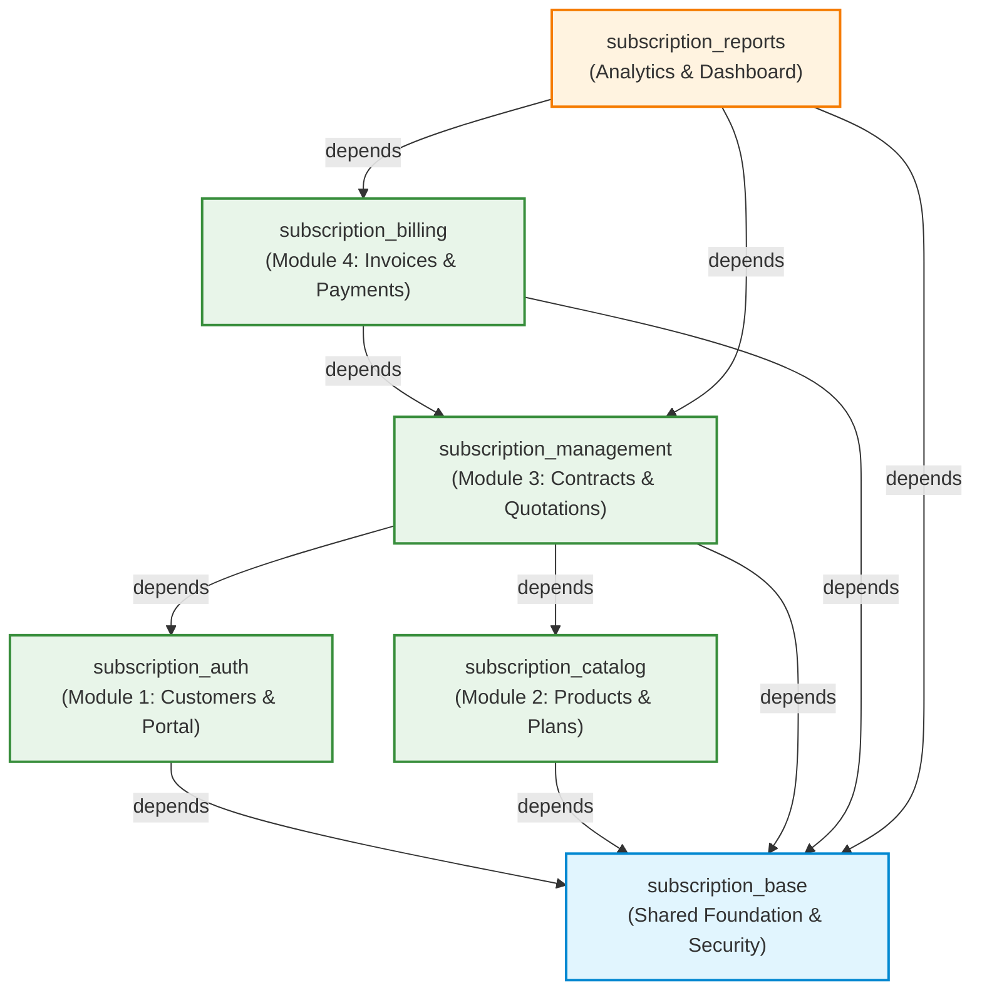

# Module Dependencies and Architecture Mapping

This document details the inter-module dependency graph, integration contracts, and native Odoo model mappings for the **Subscription Management System**.

---

## 1. Module Dependency Graph (Directed Acyclic Graph)

The system is designed with a strict Directed Acyclic Graph (DAG) architecture. Dependencies only flow downward toward foundational modules. **Circular dependencies are strictly forbidden.**



---

## 2. Dependency Specification Table

| Module Technical Name | Module Role | Depends On (Project Modules) | Depends On (Odoo Core Modules) |
|---|---|---|---|
| `subscription_base` | Foundation & Security | *None* | `base`, `mail` |
| `subscription_auth` | Module 1: Auth & Customers | `subscription_base` | `base`, `portal` |
| `subscription_catalog` | Module 2: Products, Plans & Taxes | `subscription_base` | `base`, `product` |
| `subscription_management` | Module 3: Quotations & Subscriptions | `subscription_base`, `subscription_auth`, `subscription_catalog` | `base` |
| `subscription_billing` | Module 4: Invoices & Payments | `subscription_base`, `subscription_management` | `base`, `account` |
| `subscription_reports` | Dedicated Analytics & Pivot | `subscription_base`, `subscription_management`, `subscription_billing` | `base` |
| `subscription_module_template` | Reusable Scaffold Template | *Standalone* | `base`, `mail` |

---

## 3. Integration Contracts & Data Sharing

| Source Module | Target Module | Shared Data / Interface Contract | Purpose |
|---|---|---|---|
| `subscription_base` | All Modules | Security groups (`group_subscription_user`, `group_subscription_manager`), root menu (`menu_subscription_root`), audit mixin (`subscription.audit.mixin`). | Common authorization, shared UI menu tree, audit fields (`company_id`, `currency_id`). |
| `subscription_auth` | `subscription_management` | Customer partner records (`res.partner`) where `is_subscription_customer = True`. | Restricts subscription creation to valid customer accounts. |
| `subscription_catalog` | `subscription_management` | Subscription plans (`subscription.plan`) and subscription products (`product.template` where `is_subscription_product = True`). | Defines contract recurrence interval, trial periods, and selectable line items. |
| `subscription_management` | `subscription_billing` | Confirmed subscriptions (`subscription.subscription`), recurring line items (`subscription.subscription.line`), and `next_billing_date`. | Triggers recurring invoice generation when billing date is due. |
| `subscription_billing` | `subscription_management` | Customer invoices (`account.move`), invoice status (`state`, `payment_state`), and payment reconciliation records. | Displays invoice count and payment statuses directly on the subscription contract. |
| `subscription_management` + `subscription_billing` | `subscription_reports` | Subscription records and linked invoice/payment amounts. | Materialized reporting view (`subscription.report`) for recurring revenue (MRR/ARR) and churn analytics. |

---

## 4. Native Odoo Model Reuse Strategy

To maintain high performance, avoid reinventing the wheel, and ensure seamless compatibility with Odoo's ecosystem, **do not build duplicate models**. Use Odoo's native models through model inheritance (`_inherit`):

```text
┌─────────────────────────────────┬─────────────────────────────────┬───────────────────────────────────────────┐
│ Business Concept                │ Native Odoo Model               │ Extension Mechanism                       │
├─────────────────────────────────┼─────────────────────────────────┼───────────────────────────────────────────┤
│ Customers & Contacts            │ res.partner                     │ _inherit = 'res.partner'                  │
│ Users & Portal Credentials      │ res.users                       │ _inherit = 'res.users'                    │
│ Products & Services             │ product.template / .product     │ _inherit = 'product.template'             │
│ Taxes & Fiscal Positions        │ account.tax                     │ Native Odoo standard engine               │
│ Invoices & Billing Documents    │ account.move / .move.line       │ _inherit = 'account.move'                 │
│ Customer Payments               │ account.payment                 │ Native Odoo standard payment register     │
│ Payment Transactions / Gateway  │ payment.transaction             │ Native Odoo payment provider engine       │
│ Company & Multi-Company         │ res.company                     │ Native Odoo multi-company environment     │
│ System Settings                 │ res.config.settings             │ _inherit = 'res.config.settings'          │
└─────────────────────────────────┴─────────────────────────────────┴───────────────────────────────────────────┘
```

### Why We Never Duplicate Financial Models:
1. **Double Entry Accounting:** Odoo's `account.move` maintains journal items (`account.move.line`), debit/credit equality, and foreign exchange balancing out of the box.
2. **Reconciliation:** Using native `account.payment` ensures automatic invoice reconciliation, partial payment allocation, and bank statement matching.
3. **Tax Compliance:** Odoo's `account.tax` handles inclusive/exclusive calculation, compound rates, and fiscal reporting without custom math errors.

---

## 5. Idempotent Invoicing Contract

To prevent duplicate billing during scheduled cron executions or manual retries:
1. When generating a recurring invoice, `subscription_billing` checks if an invoice already exists for the current subscription and billing cycle.
2. The created `account.move` record stores `subscription_id` as an indexed foreign key.
3. After invoice creation, `next_billing_date` on `subscription.subscription` is incremented atomically according to the plan's `billing_interval` and `billing_period`.
